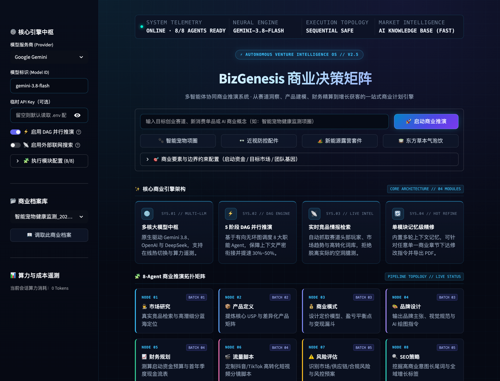
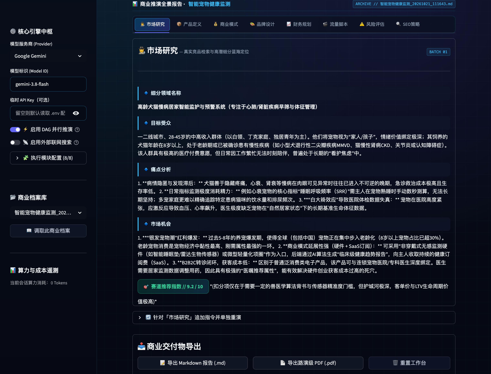
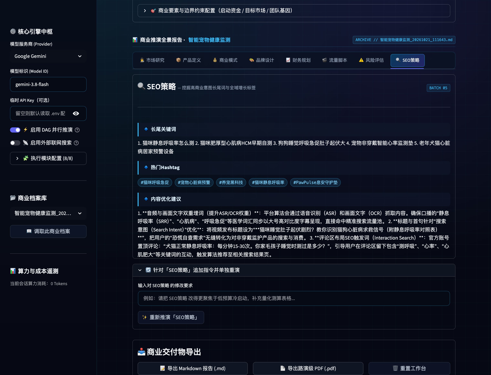
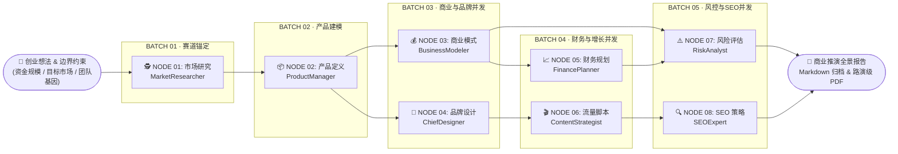

<div align="center">

# 🚀 BizGenesis · AI 商业决策矩阵

**Autonomous Venture Intelligence OS // 多智能体协同商业推演与创业辅助系统**

[](https://www.python.org/)
[](https://streamlit.io/)
[](https://github.com/reedtang666/BizGenesis)
[](./tests)
[](./LICENSE)

[**🇨🇳 中文文档**](#中文文档) &nbsp;｜&nbsp; [**📸 系统截图**](#-系统界面预览-screenshots) &nbsp;｜&nbsp; [**🕸️ 5-Stage DAG 拓扑**](#️-5-阶段-dag-并行推演架构) &nbsp;｜&nbsp; [**🛠️ 快速开始**](#️-快速开始) &nbsp;｜&nbsp; [**🇺🇸 English**](#english-documentation)

<br/>


*“让创业从玄学变工程学” —— 从赛道洞察、产品建模、财务精算到全域获客的一站式 AI 商业计划引擎*

</div>

---

<a name="中文文档"></a>

## 📖 项目简介

**BizGenesis** 是一套面向创业者、产品经理与投资分析人员的 **多智能体协同商业推演系统（Multi-Agent Venture Intelligence OS）**。只需输入一个创业赛道、新消费单品或 AI 商业概念，系统即可调度 **8 位专业职能 AI Agent**，结合实时市场检索与商业要素约束（启动资金、目标市场、团队形态），通过 **5 阶段有向无环图（DAG）并行引擎** 自动推演并输出路演级商业计划书。

### 🌟 核心架构升级 (V2.5)

| 模块代号 | 核心能力 | 技术亮点 |
| :--- | :--- | :--- |
| **`SYS.01 // MULTI-LLM`** | **多核大模型中枢** | 原生支持 **Gemini 3.8**、**OpenAI**、**DeepSeek**、**通义千问 (Qwen)**、**智谱 GLM**，支持侧边栏在线热切换模型与 API Key |
| **`SYS.02 // DAG ENGINE`** | **5 阶段 DAG 并行推演** | 基于严格上下文依赖关系的 5 批次拓扑并发调度，确保前后逻辑严密衔接的同时提速 **30% ~ 50%** |
| **`SYS.03 // LIVE INTEL`** | **双模市场情报检索** | 支持 **大模型知识库极速推演** 与 **Serper / DuckDuckGo 实时联网竞品抓取** 一键切换，国内无代理环境零阻塞 |
| **`SYS.04 // HOT REFINE`** | **单模块记忆级精修与导出** | 支持针对任意单一商业章节追加修改指令（带多轮上下文记忆重演），内置历史商业档案库及 **Markdown / 路演级中文字体 PDF** 一键导出 |

---

## 📸 系统界面预览 (Screenshots)

### 1. 商业决策驾驶舱 & 8-Agent 拓扑矩阵 (`Dashboard & Topology Matrix`)
> 采用深空商业暗色网格（Cyber-Grid）与顶部实时遥测 HUD，集成快捷赛道灵感胶囊、商业边界约束配置、4 大核心引擎架构卡以及 8-Agent 实时状态矩阵：

<div align="center">
  
</div>

### 2. 全景商业推演报告 & 赛道评分看板 (`Executive Business Report`)
> 自动将智能体输出结构化为高管简报卡片，高亮显示 **🎯 赛道推荐指数**、细分蓝海定位、受众画像与痛点分析，并支持在左侧「📂 商业档案库」随时调取历史方案：

<div align="center">
  
</div>

### 3. 单模块记忆级精修 & 路演级交付物导出 (`Hot Refinement & PDF/MD Export`)
> 内置赛博胶囊标签（`#Hashtag`）渲染、单章节独立追加指令重演面板，以及原生支持中文字体排版的路演级 PDF 与 Markdown 报告一键下载：

<div align="center">
  
</div>

---

## 🧩 8-Agent 虚拟商业团队矩阵

| 节点编号 | 智能体角色 | 执行批次 | 上游依赖输入 | 核心交付物产出 |
| :---: | :--- | :---: | :--- | :--- |
| **NODE 01** | 🕵️ **市场研究** (`MarketResearcher`) | `BATCH 01` | 用户赛道想法 + 商业约束 + 联网情报 | 高潜细分蓝海定位、目标受众画像、核心痛点、赛道推荐指数 |
| **NODE 02** | 📦 **产品定义** (`ProductManager`) | `BATCH 02` | `市场研究` | 产品命名、核心卖点 (USP)、差异化竞争壁垒、软硬件/服务定价策略 |
| **NODE 03** | 💰 **商业模式** (`BusinessModeler`) | `BATCH 03` | `产品定义` | 多元收入来源、成本结构拆解、盈亏平衡点测算、B2C/B2B2C 变现路径 |
| **NODE 04** | 🎨 **品牌设计** (`ChiefDesigner`) | `BATCH 03` | `产品定义` | 品牌理念主张、Logo 视觉规范、标准色彩体系、Midjourney 绘图 Prompt |
| **NODE 05** | 📈 **财务规划** (`FinancePlanner`) | `BATCH 04` | `商业模式` | 启动资金预算表、月度固定成本、首年四季度现金流预测、关键财务指标 |
| **NODE 06** | 🎬 **流量脚本** (`ContentStrategist`) | `BATCH 04` | `品牌设计` | 黄金前 3 秒钩子、抖音/TikTok 分镜带货脚本、转化 CTA、BGM 音效设计 |
| **NODE 07** | ⚠️ **风险评估** (`RiskAnalyst`) | `BATCH 05` | `商业模式` + `财务规划` | 市场/竞争/供应链/财务/合规五维风险识别、应对策略与止损应急预案 |
| **NODE 08** | 🔍 **SEO 策略** (`SEOExpert`) | `BATCH 05` | `流量脚本` | 高转化商业意图长尾词矩阵、热门标签 (`#Hashtag`)、搜索流量截流策略 |

---

## 🕸️ 5 阶段 DAG 并行推演架构

系统通过 [`AgentParallelExecutor`](src/utils/agent_parallel.py) 自动解析智能体之间的上下文依赖图（DAG），在保障下游 Agent 完整获取上游推演结论的前提下，分 **5 个阶段（Batch 01 ~ Batch 05）** 进行并发调度：



---

## 🛠️ 快速开始

### 1. 环境准备与安装

```bash
# 1. 克隆仓库
git clone https://github.com/reedtang666/BizGenesis.git
cd BizGenesis

# 2. 创建并激活虚拟环境
python3 -m venv venv
source venv/bin/activate  # Windows: venv\Scripts\activate

# 3. 安装依赖
pip install -r requirements.txt

# 4. 配置环境变量
cp .env.example .env
# 编辑 .env 填入你的大模型 API Key（也支持在 Web UI 侧边栏直接输入临时 API Key）
```

### 2. 启动方式

**方式一：启动现代化 Web 决策驾驶舱（推荐 🌟）**
```bash
streamlit run src/ui/app.py
```
启动后浏览器将自动打开 `http://localhost:8501`。

**方式二：命令行交互模式 (CLI)**
```bash
python -m src.main
```

**方式三：Docker 容器化一键部署**
```bash
docker-compose up --build
```

---

## 🔑 环境变量与配置说明

在根目录 `.env` 文件中配置（或在 Web 界面左侧「⚙️ 核心引擎中枢」实时切换）：

| 环境变量 | 必填 | 默认值 / 示例 | 说明 |
| :--- | :---: | :--- | :--- |
| `LLM_PROVIDER` | 否 | `gemini` | 默认模型提供商：`gemini` / `openai` / `deepseek` / `qwen` / `zhipu` |
| `GEMINI_API_KEY` | 按需 | `AIzaSy...` | Google Gemini API 密钥（默认推荐模型：`gemini-3.8-flash`） |
| `OPENAI_API_KEY` | 按需 | `sk-...` | OpenAI API 密钥（默认推荐模型：`gpt-4o-mini`） |
| `DEEPSEEK_API_KEY` | 按需 | `sk-...` | DeepSeek API 密钥（默认推荐模型：`deepseek-chat`） |
| `QWEN_API_KEY` | 按需 | `sk-...` | 阿里通义千问百炼 API 密钥（默认推荐模型：`qwen-turbo`） |
| `ZHIPU_API_KEY` | 按需 | `...` | 智谱清言 GLM API 密钥（默认推荐模型：`glm-4-flash`） |
| `SERPER_API_KEY` | 否 | `...` | Serper.dev 谷歌搜索 API Key（可选，开启联网搜索时提供更精准竞品情报） |
| `TOKEN_MONTHLY_BUDGET` | 否 | `1000000` | 月度 Token 算力预算上限（用于侧边栏成本进度条遥测） |

---

## 📁 项目目录结构

```text
BizGenesis/
├── BizGenesis.png                  # 项目视觉海报
├── docs/
│   └── screenshots/                # Web UI 系统实机高清截图
│       ├── dashboard_overview.png  # 商业决策矩阵主控台截图
│       ├── report_analysis.png     # 商业推演全景报告截图
│       └── export_and_refine.png   # 单模块精修与交付物导出截图
├── src/
│   ├── main.py                     # CLI 命令行入口（支持并行与串行推演）
│   ├── config.py                   # 多模型与环境变量统一配置中心
│   ├── models.py                   # Pydantic 结构化数据模型
│   ├── exceptions.py               # 统一异常定义体系
│   ├── agents/                     # 8 大核心职能 AI Agent
│   │   ├── base.py                 # Agent 抽象基类（含 Token 监控、重试、错误降级、多轮精修）
│   │   ├── market.py               # 🕵️ 市场研究员（双模联网检索 + 痛点洞察）
│   │   ├── product.py              # 📦 产品经理（USP 提炼 + 差异化矩阵）
│   │   ├── business.py             # 💰 商业模式架构师（盈利模型 + 盈亏平衡测算）
│   │   ├── designer.py             # 🎨 首席设计师（品牌视觉 + Midjourney Prompt）
│   │   ├── finance.py              # 📈 财务规划师（启动资金预算 + 首年现金流预测）
│   │   ├── marketing.py            # 🎬 流量操盘手（抖音/TikTok 分镜脚本）
│   │   ├── risk.py                 # ⚠️ 风险评估师（五维风控 + 应急预案）
│   │   └── seo.py                  # 🔍 SEO 增长专家（高转化长尾词 + 热门标签）
│   ├── utils/                      # 核心引擎与工程化工具包
│   │   ├── agent_parallel.py       # ⚡ 5-Stage DAG 并行调度执行器
│   │   ├── token_monitor.py        # 📊 算力与 API 成本实时遥测器
│   │   ├── pdf_export.py           # 📄 中文字体自适应路演级 PDF 导出引擎
│   │   ├── competitor_data.py      # 📡 实时竞品情报采集器
│   │   ├── error_degradation.py    # 🛡️ 优雅降级与容错恢复模块
│   │   ├── json_output.py          # 🧱 JSON 结构化解析器
│   │   └── prompt_ab_test.py       # 🧪 Prompt A/B 实验评估框架
│   ├── tools/                      # Agent 外部工具集（搜索、财务计算器）
│   └── ui/
│       └── app.py                  # 🌐 Streamlit 商业决策矩阵 Web 界面 (V2.5)
├── tests/                          # 135+ 单元测试套件（87%+ 覆盖率）
├── output/                         # 自动归档的历史商业方案 (.md)
├── requirements.txt
├── Dockerfile
└── docker-compose.yml
```

---

## 🧪 自动化测试与质量保障

项目内置 **135+ 单元测试用例**，核心工具模块覆盖率达 **87%+**：

```bash
# 运行全部测试套件
./venv/bin/python -m pytest tests/ -v

# 运行测试并输出代码覆盖率报告
./venv/bin/python -m pytest tests/ --cov=src/utils --cov-report=term
```

---

<a name="english-documentation"></a>

## 🇺🇸 English Documentation

### 📖 Overview

**BizGenesis** is an AI-powered **Autonomous Venture Intelligence OS** that transforms raw startup ideas into investor-ready business plans. Powered by an **8-Agent virtual executive team** and a **5-Stage DAG Parallel Execution Engine**, BizGenesis delivers end-to-end venture analysis—from market positioning and product definition to financial projections, viral video scripts, and SEO growth strategies.

### ✨ Key Highlights

- 🤖 **8 Specialized AI Agents**: Market Researcher, Product Manager, Business Modeler, Chief Designer, Finance Planner, Content Strategist, Risk Analyst, and SEO Expert.
- ⚡ **5-Stage DAG Parallel Execution**: Automatically resolves upstream/downstream context dependencies across 5 execution batches, boosting speed by **30%–50%**.
- 🌐 **Multi-LLM Neural Hub**: Native support for **Google Gemini (`gemini-3.8-flash`)**, **OpenAI (`gpt-4o-mini`)**, **DeepSeek (`deepseek-chat`)**, **Alibaba Qwen**, and **Zhipu GLM**, with live hot-swapping in the sidebar.
- 🖥️ **Cyber-Grid Executive Web UI (V2.5)**: Real-time telemetry HUD, live streaming agent previews, interactive business constraint selectors, historical archive loader, single-section memory refinement, and 1-click **Markdown / Chinese-ready PDF** export.
- 🛡️ **Production-Grade Reliability**: Built-in token cost telemetry, graceful error degradation, structured JSON parsing, and **135+ unit tests**.

### 🚀 Quick Start

```bash
git clone https://github.com/reedtang666/BizGenesis.git
cd BizGenesis
python3 -m venv venv && source venv/bin/activate
pip install -r requirements.txt
cp .env.example .env

# Launch Web UI
streamlit run src/ui/app.py
```

---

## 📝 更新日志 (Changelog)

### v2.5.0 (2026-10)
- 🎨 **全新 Cyber-Grid 商业决策矩阵 UI**：新增顶部 4 联实时遥测 HUD、快捷赛道灵感胶囊、商业边界约束面板与 8-Agent 实时脉动拓扑矩阵
- ⚡ **5 阶段 DAG 依赖拓扑升级**：重构 `AGENT_DEPENDENCIES`，严格按照「市场 → 产品 → 商业+设计 → 财务+脚本 → 风控+SEO」5 批次并发推演
- 🔄 **单模块记忆级精修 & 商业档案库**：支持对任意章节追加修改指令单独重演，支持一键调取 `output/` 历史归档报告
- 📡 **双模市场情报开关**：新增「外部联网搜索」独立开关，默认使用大模型知识库极速推演，彻底解决国内无代理环境下网络搜索卡顿问题
- 📄 **路演级中文字体 PDF 导出**：自动匹配 macOS / Windows / Linux 系统级中文字体，支持 Markdown 富文本符号清洗与水印排版

### v2.0.0
- ✅ 新增并行执行器、Token 成本监控、错误降级机制、Prompt A/B 测试框架及 135+ 单元测试套件

---

## 📄 License

本项目基于 [MIT License](./LICENSE) 开源。如果这个项目对你有帮助，欢迎点亮一颗 **Star ⭐**！
